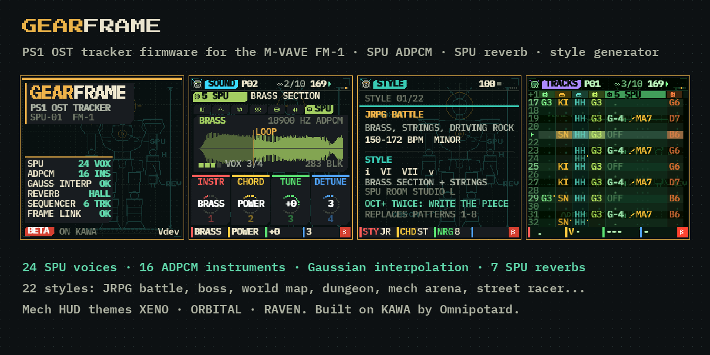

# GEARFRAME: PS1 Soundtrack Tracker for the M-VAVE FM-1

GEARFRAME is a free tracker firmware for the **M-VAVE FM-1**, built for writing music in the style of **late-90s
PlayStation soundtracks**: JRPG battle themes, boss fights, world maps and towns, mech-arena breakbeats, arcade-racer
techno and jungle, survival-horror trip-hop. It plays its instruments the way the PlayStation's sound chip (the SPU)
did:

- **24 SPU voices** (four per track): real SPU ADPCM samples, 16-byte blocks of 28 samples, decoded with the chip's own
  **4-point Gaussian interpolation**. Each voice has its own ADSR, so a new note lets the last one ring out.
- **16 instruments in the bank**: strings, choir, horns, orchestra hit, piano, e.piano, slap bass, fretless, synth bass,
  harp, wood flute, chimes, warm pad, power chord, timpani and rave stab. They come as 22 factory sounds, some with
  built-in chords. They are synthesised and then encoded as the SPU encodes them; no recording of anyone's is used.
- **The SPU's reverb**: the chip's actual algorithm (reflections, combs, all-passes at 22050 Hz) with its seven rooms:
  HALL, STUDIO L / M / S, ROOM, HALF ECHO and SPACE ECHO. This is the sound that soaked every PS1 soundtrack.
- **A style generator**: 22 styles, from JRPG BATTLE, BOSS BATTLE, WORLD MAP and TOWN to MECH ARENA, HANGAR,
  STREET RACER, NIGHT RACER and SAVE ROOM. OCT+ twice writes a whole piece into eight patterns: the chords, the
  bass, the drums or the orchestra, the tempo, the key and the reverb room.
- **A mech's HUD**: a frame's blueprint behind every page, chamfered panels, a head with a scanning visor in the
  corner, and a boot sequence that scans the frame in. There are three themes (XENO, ORBITAL, RAVEN), plus KAWA's.

Underneath it is [KAWA](https://github.com/guizmoh/Kawa-Tracker-Fm1) by Omnipotard, by way of Wonderblue-OS: the
six-track tracker, the patterns and the song chain, tables, groove, 32 live effects, KAWA's own pulse, wave, noise,
FM, kit and break engines, undo, projects and MIDI clock.

> **Beta 0.1. It has not been tried on a real FM-1.** It passes every check that runs without the hardware: the
> simulator, the tests (an 18-minute stress test of every sound at the ends of its knobs) and the web emulator. The
> firmware package is built by GitHub Actions. Installing an unofficial firmware is at your own risk, but you can
> always go back to the official one (see below).

## Try it

- **In a browser**: open [`emulator/index.html`](emulator/index.html). The firmware runs there unchanged, compiled to
  WebAssembly. Click *POWER ON*, press a key, then **SCL** three times for the **STYLE** page.
- **On the FM-1**: the package `gearframe-0.1.fwsc` is attached to each build of this branch: GitHub, *Actions*,
  *build*, the latest run, then *Artifacts*, *gearframe*. Install it as you would KAWA: plug in the FM-1 with a USB
  **data** cable, close every other MIDI program, then run `python3 install/fm1_install.py gearframe-0.1.fwsc`.
  It needs `pip install rtmidi2`; the launchers `INSTALL-*.sh/.bat/.command` set that up for you. The package is
  checked before anything is erased, and a cut install resumes at the next power-on. **Do not unplug it while it writes.**

## Write a PS1 track in a minute

1. **SCL** three times opens **STYLE**. Turn **KNOB 1** to pick a style, for example JRPG BATTLE or MECH ARENA.
   **KNOB 2** picks a chord progression and **KNOB 3** sets the energy.
2. Press **OCT+** twice. The piece is written into patterns 1 to 8 and chained.
3. Press **PLAY**. Then make it yours: **EDIT** on a track shows its SPU instrument, with the waveform and its loop.
   **KNOB 1** sets the instrument, **KNOB 2** a CHORD, **KNOB 3** the TUNE and **KNOB 4** the DETUNE (an
   ensemble). **EDIT** again gives INTERP (GAUSS, LINEAR or RAW, for the crunch), VIBRATO, CRUSH and TONE.
4. **FX** opens **SENDS**: each track's drive, echo and reverb sends. **KNOB 4** is the **SPU ROOM**, the reverb of
   the whole song.

On an SPU track, the **ARP** trick of a cell plays its chord **at once**, as a block chord the way a game's
sequencer wrote them, not as a chip arpeggio. **ARP + PRESETS** switches a track's engine. SPU is the seventh
engine, after KAWA's six.

## Controls

Same as KAWA, plus the **STYLE** page after SCALE and MAGIC on **SCL**. HOME held shows the help of the page you are
on. The bottom line always says what the four knobs do. KAWA's manual covers everything else:
[the manual](https://guizmoh.github.io/Kawa-Tracker-Fm1/manual/index.html). The French and Spanish READMEs in
this repository are KAWA's.

## Go back to the official firmware

Exactly as with KAWA. Your projects are lost (the official firmware cannot read them). Use a stable power supply
and a data cable, open the USB rescue if needed (**OCT−** held while switching on), and install M-VAVE's official
firmware **V15** with **M-UPGRADE**. Unplug nothing during the transfer.

## For developers

Everything is in [`source/`](source/BUILDING.md). This is what GEARFRAME adds to KAWA:

| | |
| --- | --- |
| `source/firmware/src/gear_spu.c` | the SPU voice: ADPCM decoding with the block flags, the pitch counter, Gaussian interpolation, per-voice ADSR, chords |
| `source/firmware/src/kawa_fx.c` | the SPU reverb (psx-spx's formula and presets) in place of KAWA's Freeverb; the echo at 22050 Hz |
| `source/firmware/src/gear_style.c` | the 22 styles and the piece they write (after Wonderblue-OS's genre generator) |
| `source/tools/gen_spu.py` | synthesises the 16 instruments and encodes them as SPU ADPCM → `firmware/gen/gear_spu.h` (75 KB) |
| `source/tools/gen_mech.py` | draws the blueprint → `firmware/gen/gear_mech.h` (240 × 240, 2 bits a pixel, 14 KB) |
| `source/tests/run_spu_test.sh`, `run_style_test.sh` | every SPU sound measured (pitch, level, release, voices, the knobs' ends) and each reverb room's decay; every style written, played and mixed |

## Credits and licence

GEARFRAME is GPL-3.0-only. It is built on **KAWA** by Omnipotard ([Ko-fi](https://ko-fi.com/omnipotard)), on
Wonderblue-OS, and on [Dinghy](https://github.com/zvenson/dinghy) (zvenson),
[Felucca](https://github.com/hugelton/Felucca) (Leo Kuroshita, Hügelton Instruments) and
[SLOOP](https://github.com/isod89/sloop-fm1) (isod89). The SPU's Gaussian table, its ADPCM filters and its reverb
presets are as documented by [psx-spx](https://psx-spx.consoledev.net/). Details are in [LICENSING.md](LICENSING.md).
"PlayStation" belongs to Sony Interactive Entertainment, and "M-VAVE" and "FM-1" belong to their owners. GEARFRAME is
neither made nor endorsed by them.
